# ESP32 Klipper Screen

*Made with [Claude](https://claude.ai): the firmware, the docs, and even the CAD for the case. A human still had to hold the screwdriver.*

A small wireless touchscreen that controls **all of your Klipper printers** from one place.
Carry it around the workshop, glance at what every machine is doing, and tap into any printer to control it.

It runs on the Waveshare ESP32-P4 touch displays: [5″](https://www.waveshare.com/esp32-p4-wifi6-touch-lcd-5.htm), and [7″, 8″ and 10.1″](https://www.waveshare.com/esp32-p4-wifi6-touch-lcd-7-8-10.1.htm). Nothing needs to be installed on your printers.

### **[→ Install it from your browser](https://supercrossed.github.io/esp32-klipper-screen/)**

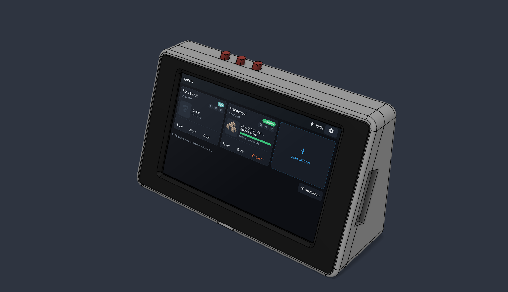

## What it does

- **All your printers on one screen.** See what each one is printing, how far along it is, when it'll finish, and its temperatures. Give printers nicknames so you know which is which. The screen updates itself: when a new version is out, one tap installs it.
- **Add printers easily.** Search your network, or type in the address.
- **Control a printer.** Start a print from its recent files (with pictures and print times), then pause, resume or cancel it. Fine-tune while printing: Z offset, speed, flow and fan. Set temperatures, home and move the axes, extrude filament, run your macros, or hit the emergency stop.
- **Get told when prints finish.** A banner and a chime when any printer finishes or fails, even if you're looking at another one.
- **History and bed mesh.** Recent jobs with lifetime totals, and a 3D view of the bed mesh you can turn and tap.
- **Console.** See the printer's console and type commands, like in Mainsail or Fluidd.
- **System controls.** Restart Klipper, restart services, or reboot and shut down the printer's computer.
- **Watch the camera** full screen.
- **Multi-material and Spoolman.** AFC (Box Turtle) and Happy Hare: see which filament is in each lane and where the loaded one is. With Spoolman, browse your spools and filaments, pick the active spool, and show a spool's QR code to scan.
- **Runs on a battery** too: plug an 18650 or LiPo into the board and the top bar shows its charge.
- **Looks the way you like.** Seven colour themes, each in light and dark, switched automatically at sunrise and sunset if you like, plus six accent colours. It also connects to Wi-Fi on first start, keeps the time, and works in landscape or portrait.

## Screenshots

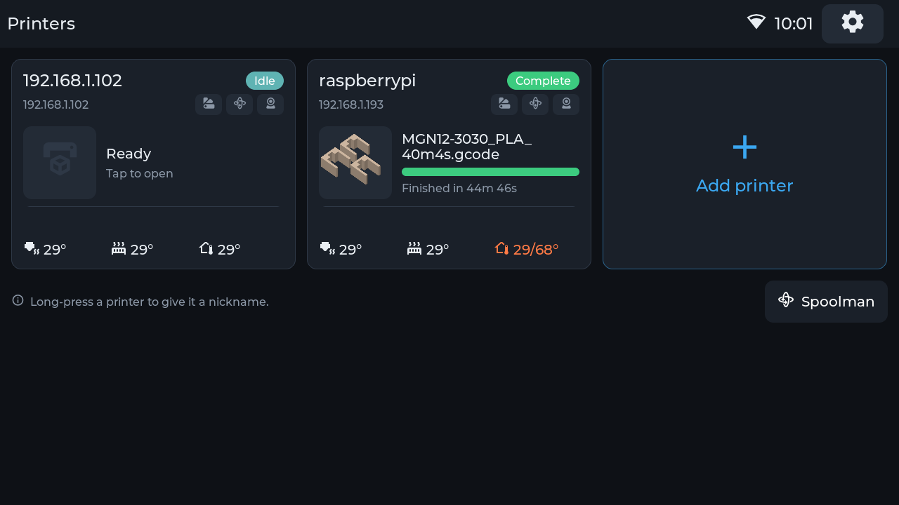

| | |
|---|---|
| 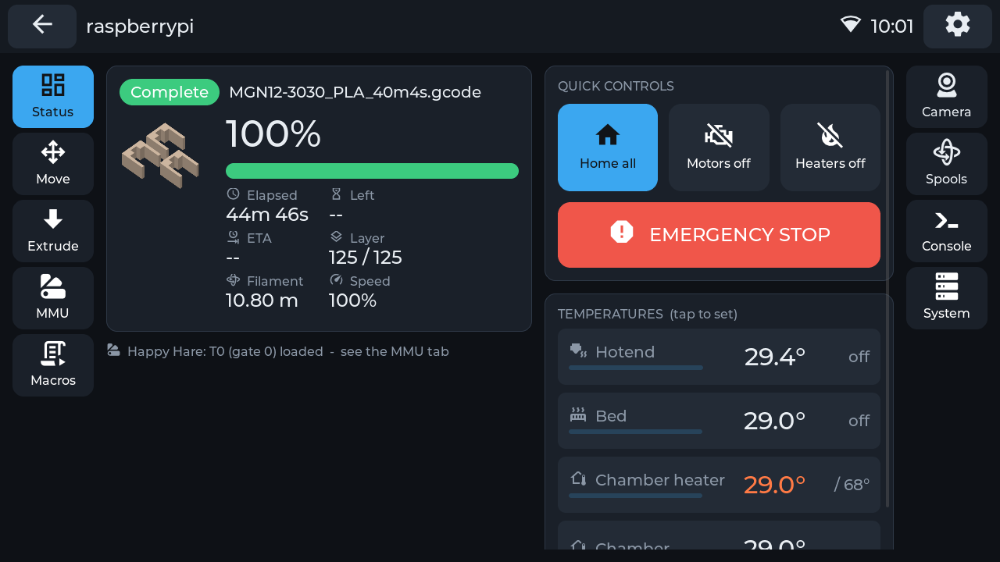 | 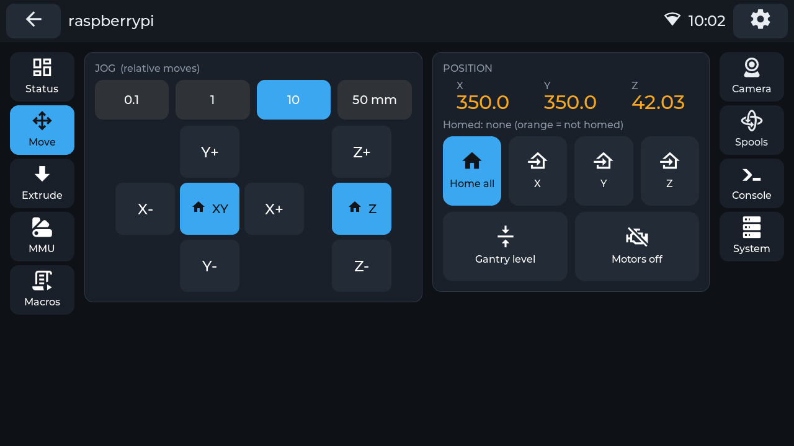 |
| **Printer status**: progress, temperatures, quick controls | **Move**: jog and home the axes |
| 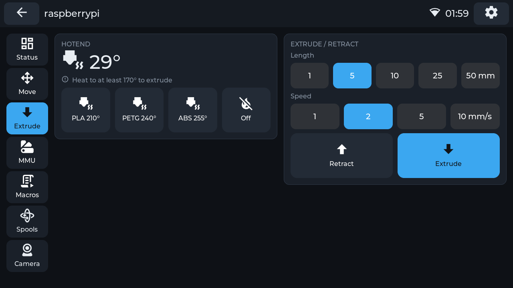 | 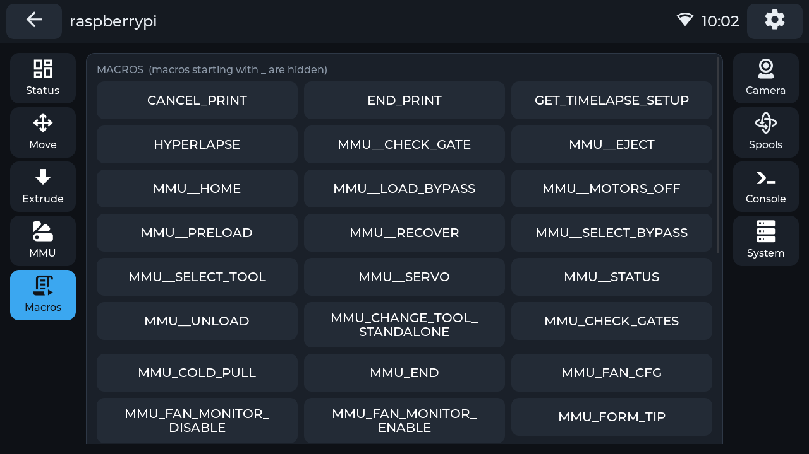 |
| **Extrude**: heat up and feed filament | **Macros**: your printer's macros as buttons |
| 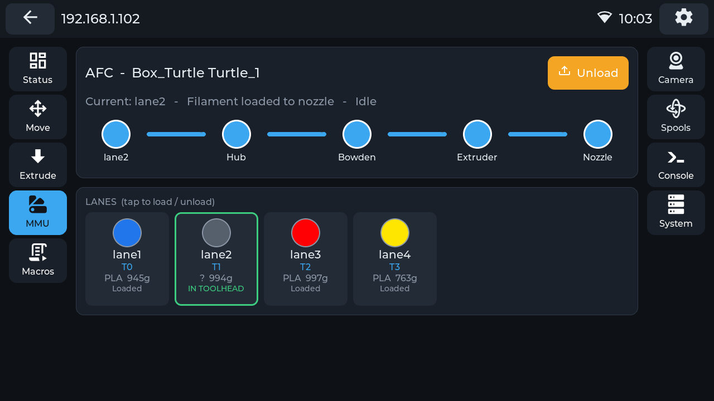 | 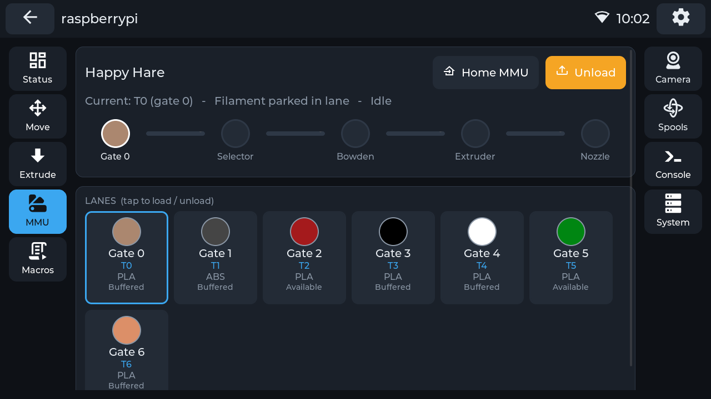 |
| **Multi-material (AFC)** | **Multi-material (Happy Hare)** |
| 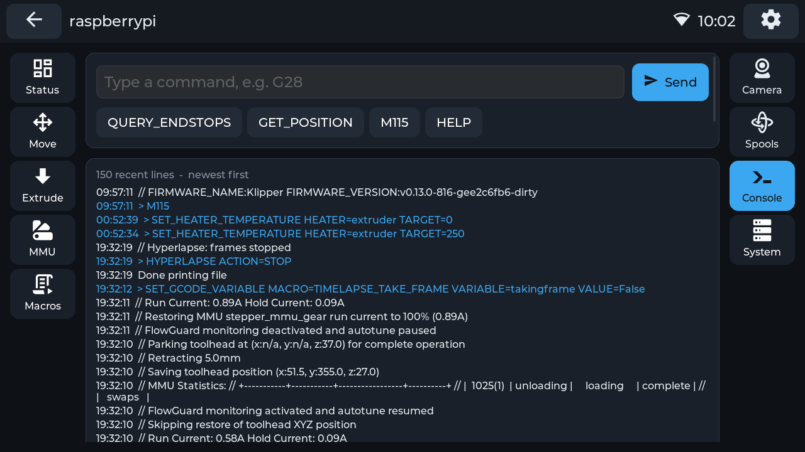 | 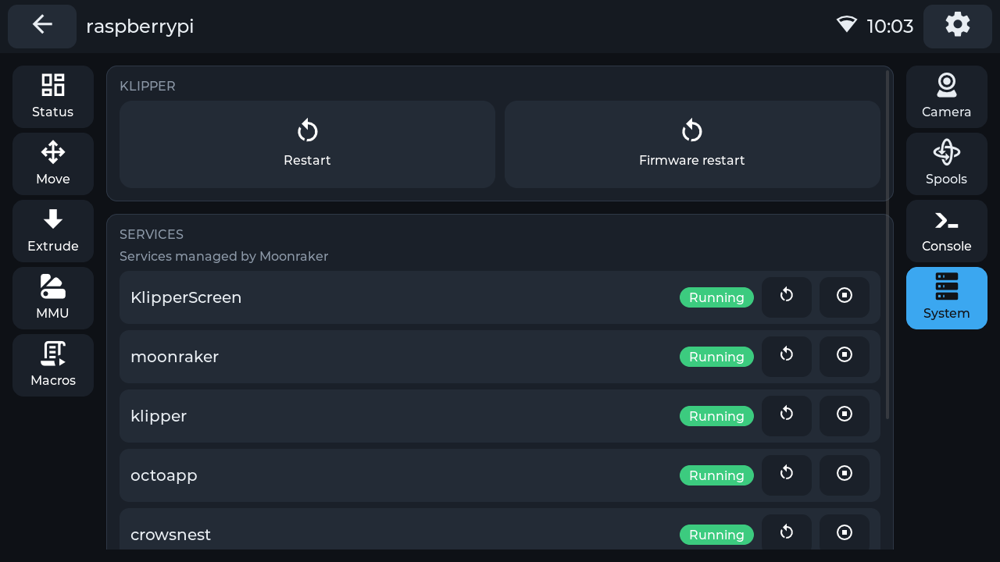 |
| **Console**: the printer's console, send commands | **System**: restart services, reboot the host |
| 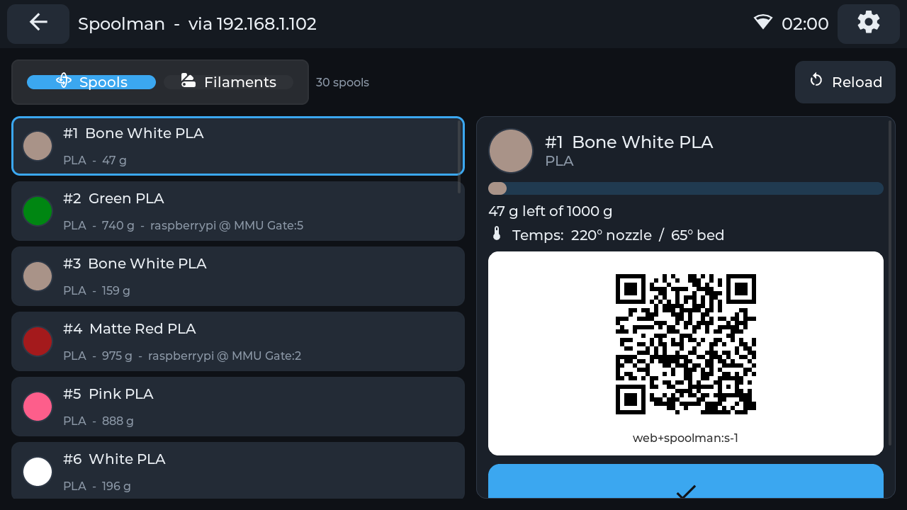 | 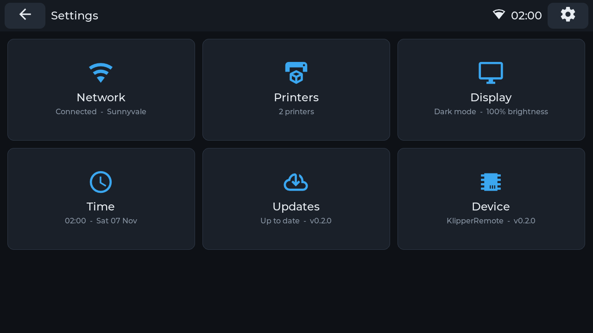 |
| **Spoolman** with a scannable spool QR code | **Settings** |
| 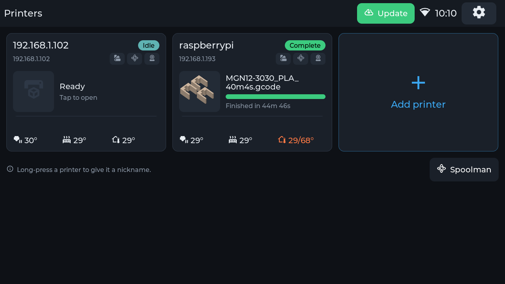 | 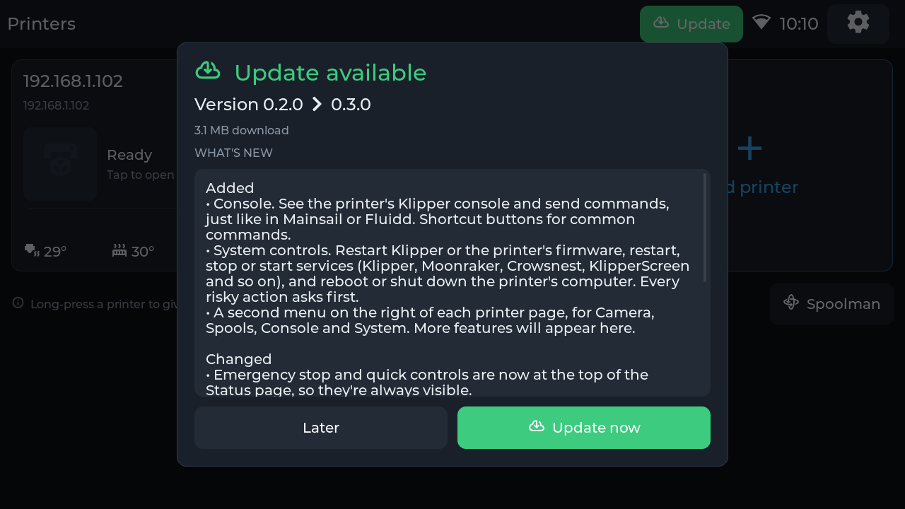 |
| A green **Update** button appears when a new version is out | See what's new, then install with one tap |

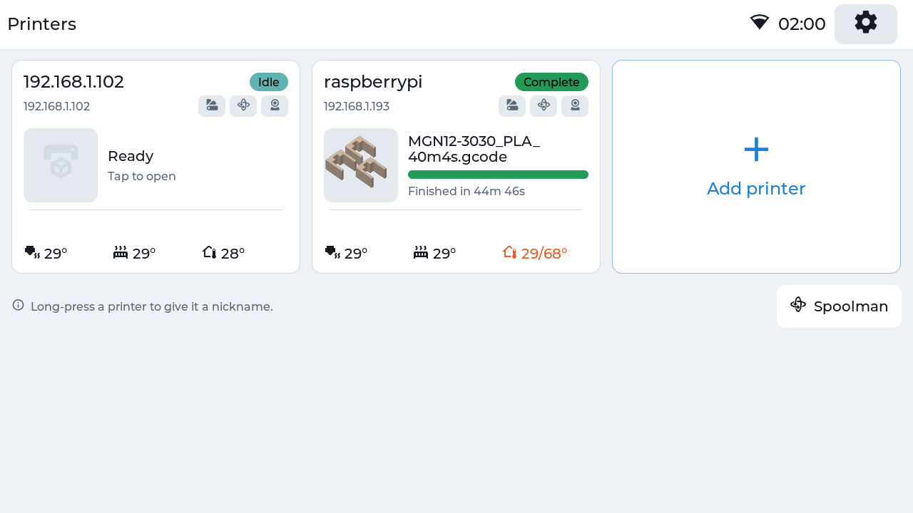

## Hardware

ESP32 Klipper Screen runs on Waveshare's ESP32-P4 all-in-one boards: a touchscreen with built-in Wi-Fi. No soldering or extra parts are needed, just a USB-C cable. Pick the size you like:

| Board | Screen | |
|---|---|---|
| **ESP32-P4-WIFI6-Touch-LCD-5** | 5″, 720 × 1280 | [Product page](https://www.waveshare.com/esp32-p4-wifi6-touch-lcd-5.htm). The desk case is made for this one. |
| **ESP32-P4-WIFI6-Touch-LCD-7** | 7″, 720 × 1280 | [Product page](https://www.waveshare.com/esp32-p4-wifi6-touch-lcd-7-8-10.1.htm) |
| **ESP32-P4-WIFI6-Touch-LCD-8** | 8″, 800 × 1280 | same page |
| **ESP32-P4-WIFI6-Touch-LCD-10.1** | 10.1″, 800 × 1280 | same page |

Each size has its own firmware. The installer asks which one you have, and updates keep to the right one.

- [Buy on Amazon](https://www.amazon.com/s?k=esp32+p4+5+inch&crid=1VNTQAY3AYSG2&sprefix=esp32+p4+5+inch%2Caps%2C187&ref=nb_sb_noss_1)

Your printers need **Klipper** with **Moonraker**, which comes with Mainsail, Fluidd and most Klipper setups.

**Building your own?** A DIY version with a separate ESP32-P4 board, a display and a small Wi-Fi chip is planned. A setup guide and installer for it will be added to the docs.

## Desk case

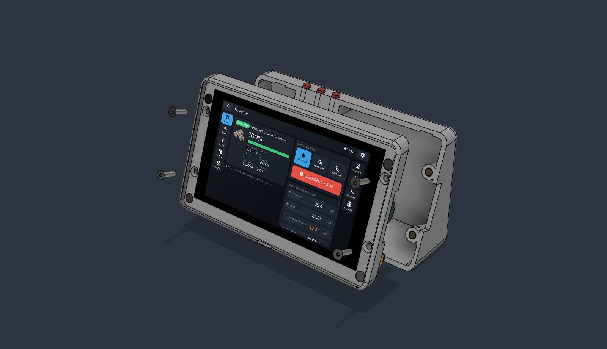

The case in the picture at the top is 3D-printable. It holds the screen at a 20° tilt, with a magnetic bezel, buttons for POWER, BOOT and RESET, and room for a battery. Every part prints without supports.

**[→ Build guide](case/README.md)**: print files, parts list and step-by-step assembly.

## Getting started

1. Open the **[web installer](https://supercrossed.github.io/esp32-klipper-screen/)** in Chrome or Edge, plug in the display, and click **Install**.
2. On the display, pick your Wi-Fi network and enter the password.
3. Tap **Add printer**, then **Start search**, and add your printers.

That's it. Future updates install from the screen.

More detail is in the [install guide](docs/INSTALL.md).

## More information

- [Install guide](docs/INSTALL.md)
- [How to use it](docs/USAGE.md)
- [Printer setup tips](docs/MOONRAKER.md): webcams, Spoolman, multi-material
- [Troubleshooting](docs/TROUBLESHOOTING.md)
- [Desk case build guide](case/README.md)
- [Building it yourself](docs/BUILDING.md) and [how it works](docs/ARCHITECTURE.md)
- [What's new](CHANGELOG.md)

Found a bug or have an idea? [Open an issue](https://github.com/supercrossed/esp32-klipper-screen/issues).

## License

[MIT](LICENSE). Icons are from [Material Design Icons](https://pictogrammers.com/library/mdi/). See [third-party notices](THIRD_PARTY_NOTICES.md).
This is a community project and isn't affiliated with Klipper, Moonraker, Mainsail, Fluidd, Spoolman, AFC, Happy Hare or Waveshare.
