# Building the desk case

A printed desk case for the **Waveshare ESP32-P4-WIFI6-Touch-LCD-5** running ESP32 Klipper Screen. The screen sits in landscape, leaning back 20°. A magnetic bezel covers the screen border, and there's room inside for a battery.

| Front | Back |
|---|---|
| 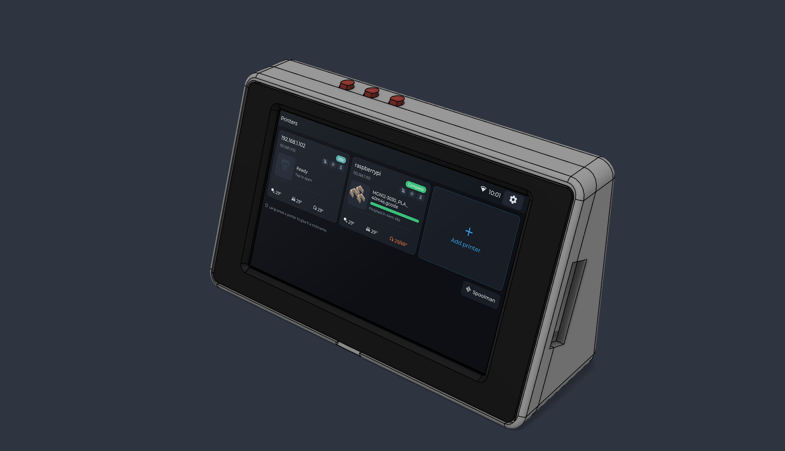 | 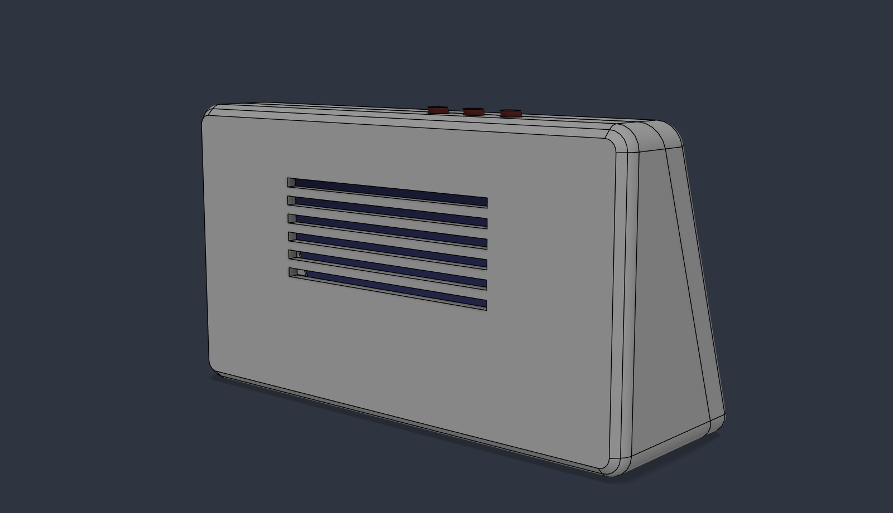 |

## Download

The print files are in [`export/`](export/), and attached to every [release](https://github.com/supercrossed/esp32-klipper-screen/releases/latest):

| File | What it is |
|---|---|
| [`esp32-p4-case-front-frame.3mf`](export/esp32-p4-case-front-frame.3mf) | Front frame (holds the display) |
| [`esp32-p4-case-body.3mf`](export/esp32-p4-case-body.3mf) | Body (battery, USB-C slot, buttons) |
| [`esp32-p4-case-bezel.3mf`](export/esp32-p4-case-bezel.3mf) | Magnetic bezel |
| [`esp32-p4-case-brackets.3mf`](export/esp32-p4-case-brackets.3mf) | 4 display brackets |
| [`esp32-p4-case-buttons.3mf`](export/esp32-p4-case-buttons.3mf) | 3 button plungers |
| [`esp32-p4-case-assembly.step`](export/esp32-p4-case-assembly.step) | Full assembly, for editing in your own CAD |

---

## What you need

### Printed parts
Every part prints without supports.

| File | Qty | Print orientation |
|---|---|---|
| `esp32-p4-case-front-frame.3mf` | 1 | Face up, flat back on the bed |
| `esp32-p4-case-body.3mf` | 1 | Standing on its closed back |
| `esp32-p4-case-bezel.3mf` | 1 | Face up |
| `esp32-p4-case-brackets.3mf` | 4 | Flat plate on the bed, legs up |
| `esp32-p4-case-buttons.3mf` | 3 | Lying on the flat side of the "D" |

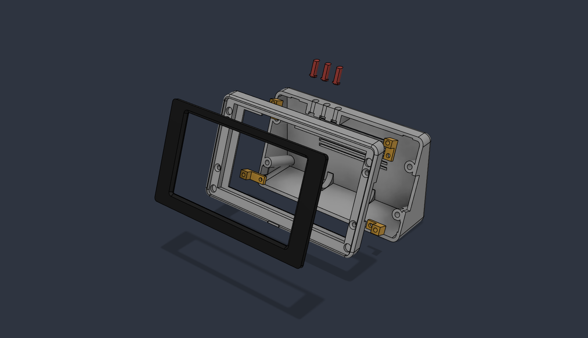

Suggested settings are PLA or PETG, 0.2 mm layers, 3 walls and 15–20% infill. The only overhangs are a few short bridges (the USB notch, the button-hole tops and the magnet pocket roofs), and any slicer handles those.

### Hardware

| Qty | Part | Where it goes |
|---|---|---|
| 4 | M3 heat-set insert, 5 mm OD, about 5–9 mm long | Body joint columns |
| 4 | M3 heat-set insert, 5 mm OD, **4 mm long** | Back of the front frame |
| 4 | M3×10 or M3×12 countersunk screw | Front frame to body (hidden under the bezel) |
| 4 | M3×12 socket-head screw | Brackets to front frame |
| 4 | M3×6 (or M2.5×6) socket-head screw | Brackets to the display's screw mounts |
| 8 | 6×2 mm neodymium magnet | 4 in the frame recess, 4 in the bezel |
| 1 | 18650 cell (protected) or a flat LiPo pouch, optional | Battery cradle, with an MX1.25 lead to the board's BAT connector |

The board has no battery protection chip of its own, so use a protected cell or a pack with a protection circuit.

### Tools
- Soldering iron with a heat-set insert tip, or a plain conical tip
- 2 mm and 2.5 mm hex keys
- Superglue or a dab of epoxy for the magnets
- VHB or foam tape for the battery

---

## 1. Melt the inserts into the body

Melt the four longer inserts into the joint columns inside the body, working from the open front. Push each one in until it's flush with the front edge.

The columns lean back 20° to match the screen. Keep the iron square to the front edge, not vertical, so the inserts go in straight.

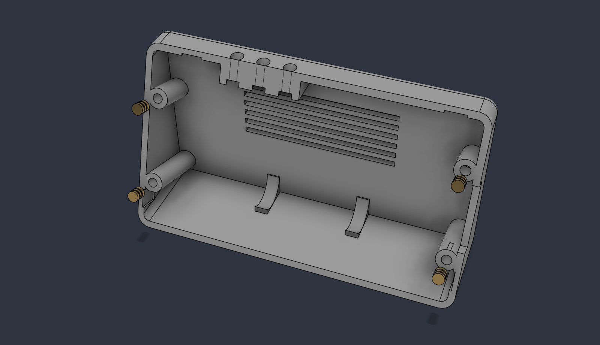

## 2. Melt the inserts into the front frame

Turn the front frame over and melt the four **short** (4 mm) inserts into the holes on its back face. The frame is only 6 mm thick here, so use light pressure and stop as soon as each insert is flush. Pushing further can bulge the skin under the bezel recess.

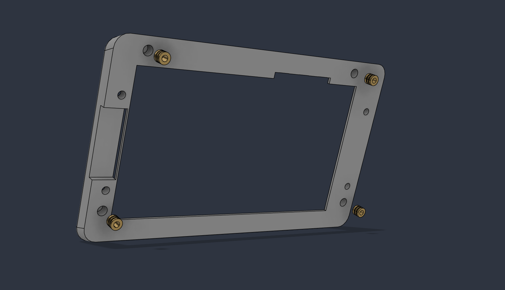

## 3. Glue in the magnets

Do this after the inserts, so the iron's heat doesn't soften the glue.

Glue four magnets into the pockets in the frame's bezel recess.

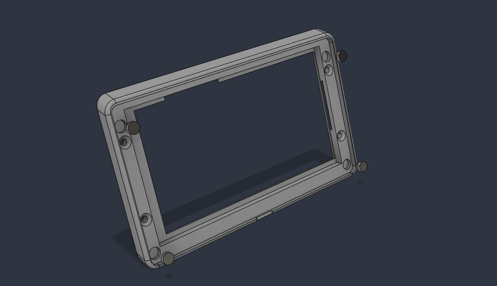

Then glue four magnets into the back of the bezel. **Check the polarity before the glue sets.** Hold each bezel magnet against its frame magnet first, so every pair attracts.

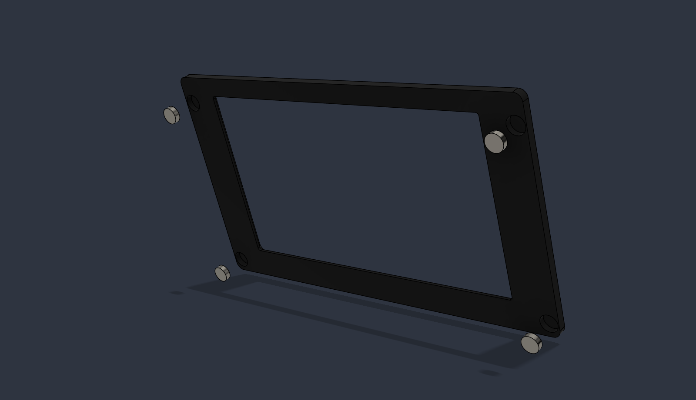

## 4. Fit the display into the frame

Lay the front frame face down on a soft cloth. Drop the display in glass-first, so the glass sits in the pocket and rests on the ledge. The USB-C ports go on the side with the notch.

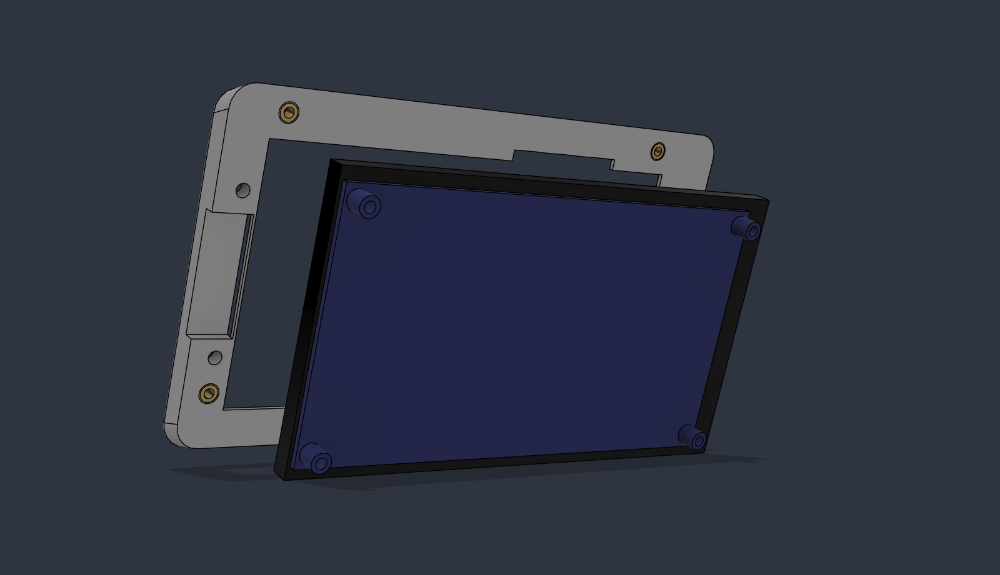

## 5. Screw on the brackets

Each bracket sits flat on one of the display's four screw mounts. Its leg lands on a brass insert in the frame.

1. Screw each bracket to the display with an M3×6 (or M2.5×6) screw.
2. Screw its leg into the frame insert with an M3×12.

Snug both up evenly. Don't crank them: the display only needs holding, not clamping.

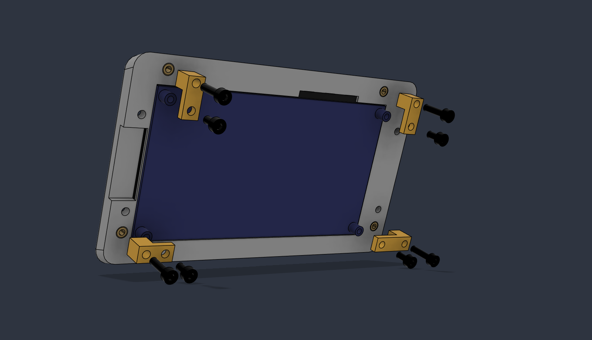

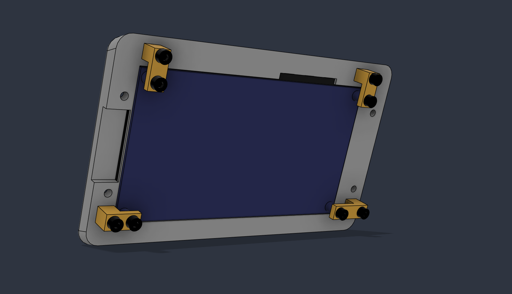

## 6. Fit the buttons and the battery

From the open front of the body, push the three buttons up into their guides with the flat side facing the front. The flat keys the D-shaped holes, so they only go in one way. Their flanges stop them falling out once the display is in.

If you're using a battery, lay it in its cradle on the floor and fix it with a strip of VHB or foam tape. Route the lead so it reaches the board's **BAT** connector.

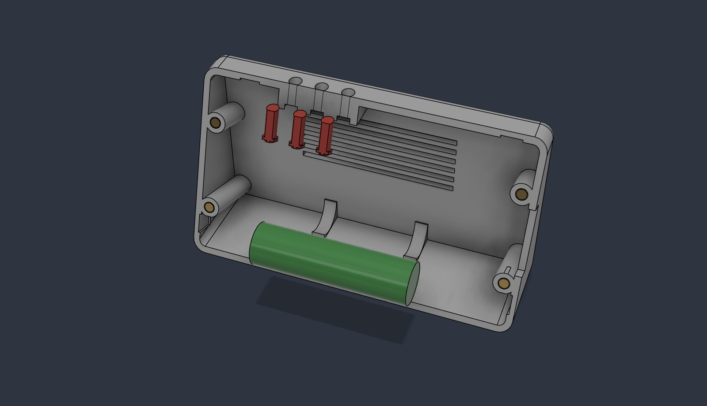

## 7. Join the frame to the body

1. Plug the battery into the board.
2. Offer the frame assembly up to the body. The three switches at the top edge of the PCB should line up under the button nubs.
3. Fix the frame with four countersunk M3 screws through the bezel recess into the body inserts. The bezel will hide them.

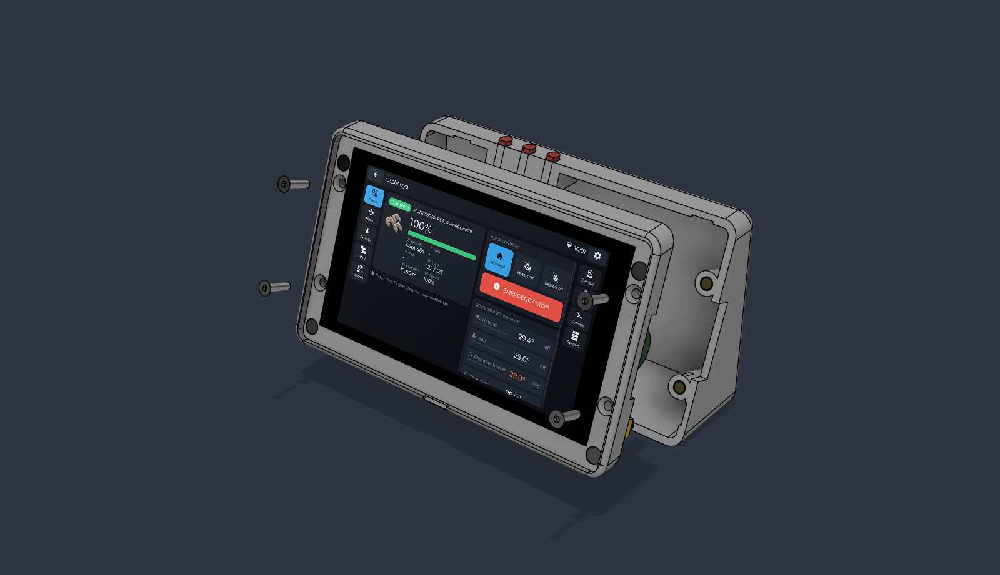

## 8. Fit the bezel

Press the bezel into the recess, and the magnets will pull it home. To take it off, lift it at the finger notch in the bottom rim.

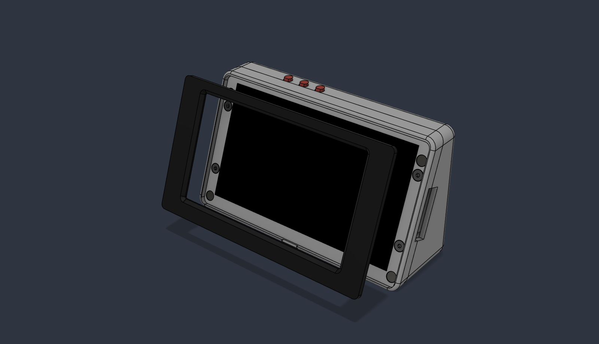

## Done

The buttons give you POWER, BOOT and RESET from the top of the case, and the USB-C ports are open on the right-hand side.

Next, [install the firmware](../docs/INSTALL.md) if you haven't yet. You can still reach the USB-C port with the case closed.

---

### Changing the design
The case is generated by a Fusion script in [`fusion/EspP4Case`](fusion/EspP4Case). [DESIGN.md](DESIGN.md) lists its parameters, the measurements worth checking before you print, and how to rebuild the model, the print files and the images in this guide.
