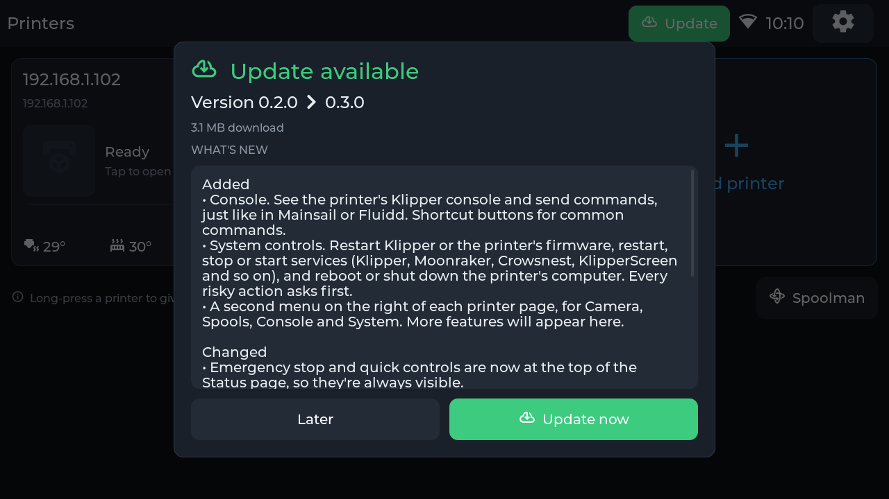

# Using it

The screen runs in landscape by default (1280×720 on the 5″ and 7″, 1280×800 on the 8″ and 10.1″). The top bar shows a **Back** arrow, the page title, the Wi-Fi signal, the clock, and **Settings**.

## Home

Each printer has a tile, sized to be readable from across a desk. With one to four printers there are two columns (one in portrait), and the tiles share the screen height; with five or more there are three columns. Every tile has the same layout:

1. **Name and status**: Idle, Printing, Paused, Complete, Error, Offline or Klipper not ready.
2. **Address**, with small icons when the printer has an MMU, Spoolman or a camera.
3. **Job**: the slicer thumbnail (or a printer icon), file name, progress bar, and time left with ETA.
4. **Temperatures**: hotend, bed and chamber in three columns, orange while heating and `--` when the printer doesn't have one.

**Tap** a tile to open the printer. **Long-press** it to set a nickname. **+ Add printer** is in the bottom bar (a big tile while there are no printers yet). When any printer has Spoolman, a **Spoolman** button appears next to it.

When a new version is available, a green **Update** button appears in the top bar (see [Updates](#updates)).

Home tiles refresh every 3 s by default, and the open printer every 1 s. Both can be changed in *Settings → Printers*.

## Printer page

The **left bar** holds the printer's main sections: Status, Move, Extrude, MMU and Macros. The **right bar** holds extra tools: Camera, Spools, Console and System, with room for more. Only the selected section is kept in memory.

### Status
- **Quick controls** come first, so they're always on screen: Home all, Motors off, Heaters off, and **EMERGENCY STOP** (immediate, no confirmation).
- The job card shows the file, thumbnail, percentage and progress bar, followed by **Elapsed**, **Remaining**, **ETA** (clock time), **Layer**, **Filament** used and **Speed** factor.
- **Pause / Resume** and **Cancel** appear while printing. Both ask for confirmation.
- When Klipper is in an error or shutdown state, the reason is shown with **Restart** and **Firmware restart** buttons.
- **Temperatures**: tap a heater to set its target with a numpad and presets. Chamber heaters (`heater_generic`/`temperature_fan`) can be set too; a plain chamber `temperature_sensor` is read-only.

### Tune
- **Z offset (babystep):** Raise or Lower in 0.005 / 0.01 / 0.025 / 0.05 mm steps, or Reset to 0. When Z is homed the nozzle moves right away (`SET_GCODE_OFFSET … MOVE=1`). It's temporary, so save it in the printer's config to keep it.
- **Speed** (10–300 %), **Flow** (50–150 %) and **Part fan** (0–100 %) sliders. Each is sent when you let go, and has a reset button. The fan slider only appears when the printer has a `[fan]`.

### Move
- Jog step: 0.1 / 1 / 10 / 50 mm. XY pad with a centre **Home XY** button, and a Z column with **Home Z**.
- Position readout. Axes show orange until they're homed.
- Home all / X / Y / Z, **Gantry level** (`QUAD_GANTRY_LEVEL`) or **Z tilt** (`Z_TILT_ADJUST`) when the printer has them, and Motors off.
- Moves are blocked while printing.

### Extrude
- Hotend temperature with **PLA 210° / PETG 240° / ABS 255° / Off** presets.
- Length (1–50 mm) and speed (1–10 mm/s), then **Retract** or **Extrude**. Both are refused below 170 °C.
- **Load filament / Unload filament** buttons appear when the printer has `LOAD_FILAMENT` / `UNLOAD_FILAMENT` macros.

### MMU (AFC or Happy Hare only)
- The header shows the unit name, the current lane or tool, where the filament is, and the current action.
- The **filament path** lights up from the active lane through Hub/Selector → Bowden → Extruder → Nozzle, in the filament's colour.
- **Lanes** show colour, tool mapping, material, weight, and status. The lane in the toolhead has a green border.
- Tap a lane to load it (AFC `CHANGE_TOOL LANE=…`, Happy Hare `MMU_CHANGE_TOOL TOOL=…`) or to unload it. **Unload** and, on Happy Hare, **Home MMU** sit in the header. Lane changes are blocked while printing.

### Files
Tap **Files** in the left menu to see the printer's 5 most recent G-code files. Pick one to see its picture, print time, filament, layer height and slicer, then tap **Start print**. You'll be asked to confirm, and it won't start while the printer is busy.

### Macros
Every `gcode_macro` whose name doesn't start with `_`, sorted. Tap one to run it; each asks for confirmation.

### Spools (Spoolman)
Shown when the printer's Moonraker has a `[spoolman]` section.
- **Spools / Filaments** tabs list colour, name, vendor, material, grams left and location.
- Tap a spool for its details and a large **QR code** (`web+spoolman:s-<id>`) that a 2D scanner can read off the screen.
- **Set active on <printer>** or **Clear active spool**. The active spool is marked with ✓.

### Console (right bar)
The printer's recent console, the same one shown in Mainsail or Fluidd, newest first. Your commands are blue and errors red. Type a command at the top (it stays visible above the keyboard) and tap **Send**, or use a shortcut: `QUERY_ENDSTOPS`, `GET_POSITION`, `M115`, `HELP`. The console refreshes every second while open.

### System (right bar)
- **Klipper**: Restart (reloads the config) and Firmware restart.
- **Services**: every service Moonraker manages (Klipper, Moonraker, Crowsnest, KlipperScreen, …) with Running/Stopped, and Restart or Stop/Start buttons.
- **Host**: Reboot or Shut down the printer's computer.

Everything except *Start* asks for confirmation.

### History (right bar)
Lifetime totals (jobs, print time, filament) and the 5 most recent jobs with result, date, duration and filament.

### Mesh (right bar)
Shown when the printer has `[bed_mesh]`. **3D** draws the bed with the probed mesh on it as a coloured surface (blue is low, red is high), with the height exaggerated so small differences show. Drag to turn and tilt it, tap a probe point to read its X / Y / Z, and tap **Reset view** to go back to the default angle. **Top** shows one tile per probe point with its value, front of the bed at the bottom. Both have a colour scale with the lowest and highest values. You also get the range, saved profiles (tap to load), **Calibrate** (homes first if needed, and asks before starting) and **Clear**.

### Camera
Opens the printer's webcam fullscreen; if it has several, you pick one first. **Tap anywhere to close it.** The bottom strip shows the job status, resolution and frame rate.

## Settings

The top level is a grid of tiles:

| Tile | Contents |
|---|---|
| **Network** | Connection details (SSID, IP, gateway, signal, MAC) and **Choose a network** |
| **Printers** | Edit or remove printers, add one, refresh rates |
| **Display** | Theme (**Dark / Light / Auto** by sunrise and sunset), accent colour, brightness, screen rotation (a rotation change restarts the display) |
| **Time** | Clock and time zone. *Auto* detects it once from your public IP |
| **Updates** | Installed and latest version, **Check for updates**, **View update** |
| **Device** | Device name (network hostname), **alerts and sound** (banner on/off, volume, test sound), **battery**, firmware and memory info, Restart, Factory reset |

## Battery

The board has a **BAT** connector (MX1.25 on the 5″, JST 1.25 mm 2-pin on the 7/8/10.1″) for a single Li-ion or LiPo cell, such as an 18650. The board charges it from USB and stops at full. On the 5″ a protected cell is preferred but not required; the 7/8/10.1″ boards have a protection chip of their own.

- **Battery icon.** While a battery is connected, an icon in the top bar shows its charge in %: green above 50%, yellow down to 21%, red at 20% and below. A lightning bolt means it's charging. Tap the icon to open the battery settings.
- **Settings → Device → Battery** shows the status (*Charging*, *Charged*, *On battery*), the charge, the voltage and, on battery, roughly how long is left at the current brightness. Pick your **battery type** there: *Li-ion (18650)* for round cells, *LiPo* for flat packs. Each has its own voltage curve. Also pick the **battery size**; it's used for the time-left estimate and to correct the reading for the board's load. *No battery* turns all of this off.
- **The % is an estimate** worked out from the voltage, since the board has no fuel gauge. It's least accurate while charging (shown as *about*). 0% is the **Turn off when empty** point, so the number runs down to 0 just as the screen switches itself off (with *Never*, 0% is 3.0 V). To keep it steady, it only goes up while charging and only goes down on battery.
- **Turn off when empty** (default: below 3.3 V; 3.0 to 3.5 V or Never). The 5″ board has no protection chip of its own, so the screen turns itself off before the cell runs flat (on the bigger boards it turns off before their protection chip cuts in). It warns you at 15%. Plug in USB to start it again.
- **On the 5″, unplugging USB restarts the screen** for a moment (plugging it in sometimes does too). That's the board's power switch-over; it can't be avoided in software.
- **On the 5″, on battery, hold the POWER button** to turn the screen off or on. The PWR light on the back of the board stays on while it's off: the board keeps its battery converter running and draws a little current (roughly 1 mA). Unplug the battery to store the screen for weeks; the firmware can't switch that part off.
- The 7/8/10.1″ boards use a different charger and power switch. Their battery behaviour hasn't been measured yet, so the time-left estimate there is rougher (the bigger backlights draw more; that's estimated from the screen size).
- The board always charges to 4.2 V (full). A lower charge limit isn't possible: the charger has no setting the firmware can change.

## Print alerts

When any printer finishes, fails, is cancelled or stops unexpectedly, a banner slides in at the top with an **Open** button that jumps to that printer, plus a chime: rising for finished, low for a problem. It stays until you dismiss it. Several alerts queue up and show one after another. Turn banners or sound off in *Settings → Device → Alerts & sound*.

## Updates

When a newer release is out, tap the green **Update** button, or go to *Settings → Updates → View update*. You'll see what's new and the download size. **Update now** downloads and installs it with a progress bar, then the display restarts. **Later** closes the dialog, and the button stays until you update.

## Keyboard

- Text fields use a full keyboard with a number row. `1#` switches to symbols. The arrow key works like a phone: tap it once for one capital letter, double-tap it for caps lock, and tap again to go back to lower case.
- Host and port fields open an **IP numpad** with `.` and `:`. Tap `abc` for letters, and `123` to get back to the numpad.
